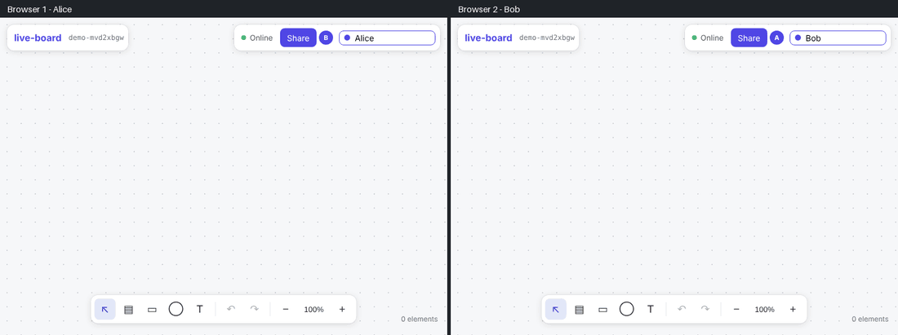
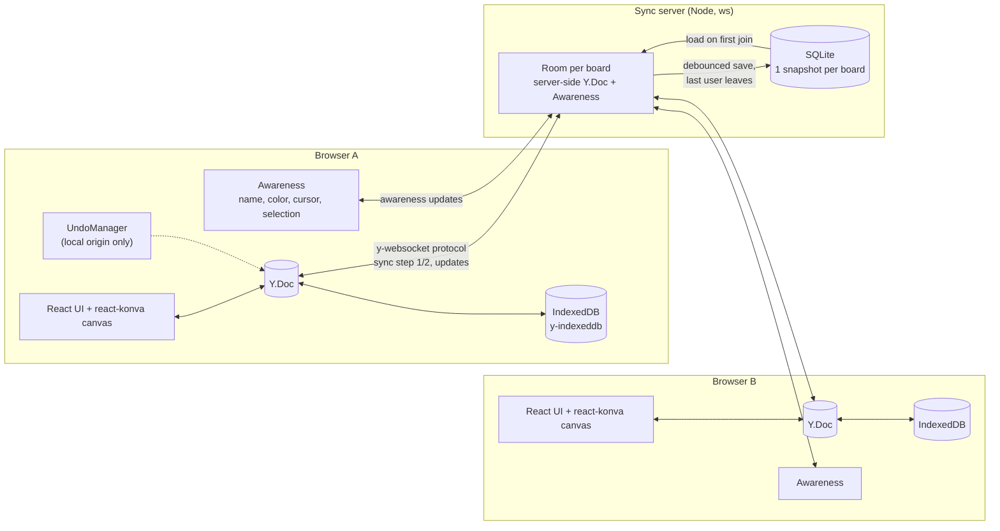

# live-board

**A real-time collaborative whiteboard, a simplified FigJam.**
Sticky notes, shapes and text that several people edit at the same time, with live cursors, per-user undo and offline editing.
Conflicts are resolved by a CRDT (Yjs), boards are shared with a link and stored on the server, and the board stays at 60 FPS with 500 elements.

[](https://github.com/Melvin2209/live-board/actions/workflows/ci.yml)




<sub>Recorded by [`scripts/record-demo.ts`](scripts/record-demo.ts): two isolated browsers edit the same board, type in the same note at the same time, then one goes offline and syncs back.</sub>

## Features

- **Canvas**: sticky notes, rectangles, ellipses and text; select (shift for multi-select), drag, resize, recolor, delete; pan with the wheel/trackpad, zoom to the cursor with ctrl + wheel or pinch.
- **Real-time collaboration**: every change is synced through a WebSocket; other people's **cursors with their name**, their selection and a presence list.
- **Conflict-free**: concurrent edits merge automatically (property by property, text character by character), with no lock and no "someone else edited this" dialog.
- **Undo / redo per user**: <kbd>Ctrl/Cmd+Z</kbd> undoes *your* changes, never a collaborator's.
- **Offline first**: the board is cached in IndexedDB; keep editing without network, everything syncs back when the connection returns.
- **Share by link**: the URL is the invitation; boards are persisted on the server (SQLite).
- **Measured performance**: an automated benchmark checks frame times with 500 elements ([results](#performance)).

## Run it locally

Requirements: **Node.js ≥ 22.13** (it uses the built-in `node:sqlite`, so there is no native module to compile).

```bash
git clone https://github.com/Melvin2209/live-board.git
cd live-board
npm install
cp .env.example .env   # optional: the defaults work locally
npm run dev            # Next.js on :3000 + sync server on :1234
```

Open <http://localhost:3000>, create a board, then open the same link in another browser or a private window to see the collaboration.

| Command | What it does |
| --- | --- |
| `npm run dev` | App (Next.js dev server) + sync server, with reload |
| `npm run build && npm start` | Production build of the app + sync server |
| `npm run lint` / `npm run typecheck` | ESLint / `tsc --noEmit` |
| `npm test` | Unit and integration tests (Vitest) |
| `npm run test:e2e` | End-to-end tests, two browsers (Playwright) |
| `npm run bench` | Performance benchmark, 500 elements (Playwright) |
| `npm run bench:doc` | Size of the CRDT data for 500 elements |

## Architecture



**Data model** ([`src/board/model.ts`](src/board/model.ts)). A board is one `Y.Doc` holding a `Y.Map` of elements. Each element is itself a `Y.Map` (`type`, `x`, `y`, `width`, `height`, `color`, `z`) plus a `Y.Text` for its content:

- two people changing **different properties** of an element (one moves it, the other recolors it): both changes are kept;
- two people changing the **same property**: Yjs picks the same winner on every peer (deterministic last-writer-wins), so everyone converges;
- two people **typing** in the same note: `Y.Text` merges the characters. The editor sends minimal diffs and keeps the caret as a Yjs *relative position*, so the texts don't interleave;
- delete vs. concurrent move: the delete wins, the element is gone for everyone.

**Sync** ([`server/room.ts`](server/room.ts)). The server is a plain Yjs peer speaking the standard `y-websocket` protocol. On connect, client and server exchange state vectors (sync step 1) and send each other only what the other is missing (step 2), then stream incremental updates. Reconnecting after offline work is the same handshake, so there is no special "merge" code path.

**Presence** uses Yjs *awareness*: ephemeral state (name, color, cursor, selection) that is not stored and disappears when a client leaves. Cursors are throttled to ~30 Hz and drawn on their own Konva layer.

**Undo/redo** ([`src/board/history.ts`](src/board/history.ts)). Every local change runs in a transaction tagged with a `LOCAL_ORIGIN`. The `Y.UndoManager` only tracks that origin, so it never reverts remote changes. Rapid changes (a drag, a burst of typing) are grouped into one step.

**Offline** ([`src/collab/useBoardSession.ts`](src/collab/useBoardSession.ts)). `y-indexeddb` stores every update locally; the WebSocket provider follows the browser's `online`/`offline` events and reconnects with backoff. The header shows the connection status.

### Project structure

```
src/
  app/                 Next.js routes: home page, /b/[boardId]
  board/               Pure logic, no React: Yjs model, store, undo, viewport math
  collab/              Session (Yjs + WebSocket + IndexedDB), presence, user identity
  components/          Canvas (react-konva), toolbar, text editor, cursors, top bar
server/                WebSocket sync server and SQLite persistence
e2e/                   Playwright tests: two browsers on the same board
bench/                 Performance benchmark (Playwright)
scripts/               CRDT size stats, demo recorder
docs/performance.md    Benchmark method and results
```

## Technical choices

| Choice | Why | Alternatives considered |
| --- | --- | --- |
| **Yjs (CRDT)** | Merges concurrent and offline edits without a central authority; mature, small updates (40 bytes for a move); awareness, undo manager and IndexedDB provider come with it. | **OT** (as in Google Docs) needs a server that orders every operation, which is harder offline. **Automerge**: also a good CRDT, but a smaller ecosystem for providers. **Last-write-wins on whole objects**: loses concurrent edits. |
| **One `Y.Map` per element** | Conflicts are scoped to a single property instead of the whole element. | A JSON blob per element: a move and a recolor at the same time would overwrite each other. |
| **react-konva** | Canvas rendering (DOM nodes don't scale to hundreds of shapes being dragged), with a declarative React API, hit-testing, drag and resize handles built in. | Raw Canvas 2D: more code for hit-testing and transforms. SVG/DOM: slower with many elements. |
| **Own sync server (~300 lines)** | Speaks the standard `y-websocket` protocol, so the client uses the official provider. Small enough to read and explain, and it lets me control persistence and room lifecycle. | Hosted services (Liveblocks, PartyKit…): less to learn from, vendor lock-in. |
| **SQLite via `node:sqlite`** | Zero setup, one file, no native build. A board is saved as one Yjs snapshot (90 KB for 500 elements), writes are debounced. | Postgres/Redis: needed only for multiple server instances. |
| **Separate WebSocket process** | Next.js route handlers are not built for long-lived WebSockets; the two scale independently. | A custom Next.js server: more coupling. |
| **Store with per-element snapshots** | `useSyncExternalStore` + immutable snapshot per element: a change re-renders only that element (`React.memo`). | Re-reading the whole doc on each change: every shape re-renders 60 times per second during a drag. |

## Testing

- **Vitest, 43 tests** ([`src/**/*.test.ts`](src), [`server/*.test.ts`](server)). They cover:
  - model operations, and conflicts between two `Y.Doc`s synced by hand: different properties, same property, concurrent typing, delete vs. move;
  - undo scoped to the local user;
  - the incremental store and the viewport math;
  - IndexedDB restore (with `fake-indexeddb`);
  - the real sync server: two clients, presence, isolation between boards, resync after offline edits, persistence across a server restart.
- **Playwright, 7 scenarios** ([`e2e/collaboration.spec.ts`](e2e/collaboration.spec.ts)) run against a production build. Each person is a separate browser context (own storage, IndexedDB and WebSocket):
  - real-time edits and drags;
  - named cursors and presence;
  - both users typing in the same note at once, plus a recolor and a move at the same time;
  - undo that leaves the other user's work alone;
  - one browser goes offline (`context.setOffline`), both keep editing, then they resync;
  - a link opened later by a fresh browser loads the board from the server.
- **CI** ([`.github/workflows/ci.yml`](.github/workflows/ci.yml)) runs lint, typecheck and Vitest, then the Playwright suite, then the benchmark. The benchmark results are added to the job summary.

## Performance

Measured by [`bench/board.bench.spec.ts`](bench/board.bench.spec.ts). The board has **500 elements, all visible on screen**, in a production build with headless Chromium on a 4-vCPU container. Each scenario records every animation frame:

| Scenario | FPS | p95 frame time | Long tasks |
| --- | --- | --- | --- |
| Pan | **60** | 16.7 ms | 0 |
| Zoom | **59.3** | 16.7 ms | 0 |
| Drag an element | **60** | 16.8 ms | 0 |
| Another user drags an element | **53.6** | 33.3 ms | 0 |
| First render of 500 elements | 130 ms | | |
| New visitor opens the link → board drawn | 646 ms | | |

The optimizations were measured with a **4× slower CPU**, where they matter. Dragging went from 22 to 52 FPS and remote drags from 10 to 40 FPS, thanks to:

- a store that only rebuilds changed elements, plus `React.memo`;
- drag updates sent once per animation frame;
- the dragged element, or one being moved by someone else, drawn on its own small layer;
- no text drawn below 40% zoom (level of detail);
- text excluded from hit-testing.

Method, raw numbers, 1000-element results and a before/after table: **[docs/performance.md](docs/performance.md)**.

## Limitations

- **No accounts or permissions**: anyone with the link can edit, which is fine for a demo but not for production. Next steps would be auth on the WebSocket upgrade and read-only links.
- **One sync server process**: rooms live in memory. Scaling out needs sticky routing per board or a pub/sub (e.g. Redis) between instances.
- **Snapshot persistence**: the whole board is rewritten on save. That is fine at this size; very large boards would want an append-only update log with periodic compaction.
- **Offline needs the page to be already open** (or the app cached by the browser): there is no service worker, so a cold offline reload doesn't work. Edits made offline are kept in IndexedDB either way.
- **Concurrent edits**: same-property edits are last-writer-wins, so if two people drag the same note at once, one position wins. The editing textarea is top-aligned while shapes center their text.
- **Pan/zoom on slow machines**: every visible shape is redrawn; on a CPU 4× slower with 500 elements on screen it runs at ~30 FPS. Viewport culling or layer caching would be the next optimizations.
- **Undo history** is in memory and lost on reload (like most editors).

## License

[MIT](LICENSE)
